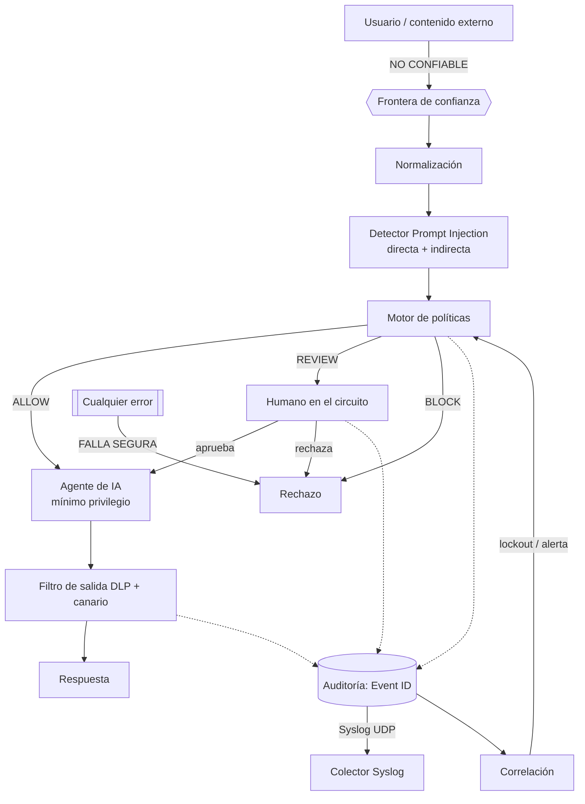

# Arquitectura



## Fronteras de confianza
| Zona | Confianza | Control al cruzar |
|---|---|---|
| Entrada del usuario | No confiable | Normalización + detección + políticas |
| Documentos, web, correos (contenido externo) | No confiable | Detección de injection indirecta + delimitadores `<datos_externos>` |
| Salida del modelo | No confiable | Filtro DLP + token canario |
| `policies.json` | Confiable (controlada) | Validación de esquema; inválida => falla segura |

## Formato Syslog
```
<PRI>Mmm dd hh:mm:ss HOST aigw[PID]: %AIGW-<SEV>-<MNEMÓNICO>: EventID=EVT-... clave=valor
PRI = Facility * 8 + Severidad      (local0 = 16; WARNING = 4  =>  <132>)
```
| Mnemónico | Severidad | Cuándo |
|---|---|---|
| `REQ_ALLOW` | 6 INFO | Solicitud permitida |
| `REQ_REVIEW` / `REVIEW_APPROVED` / `REVIEW_REJECTED` | 5 NOTICE | Humano en el circuito |
| `REQ_BLOCK` / `PROMPT_INJECTION` / `PROMPT_INJECTION_INDIRECT` / `DLP_OUTPUT_REDACTED` | 4 WARNING | Bloqueo o detección |
| `FAIL_SAFE` | 3 ERR | Error interno => denegar |
| `CORRELATION_ALERT` | 2 CRIT | Patrón de ataque correlacionado |
